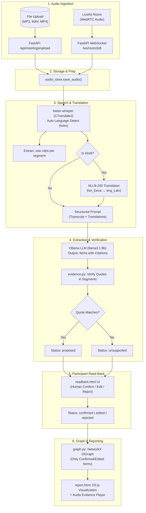

# 🏗️ Architecture & Structure Guide

> **Project**: Platform-Independent, Evidence-Linked Meeting Intelligence for Hindi–English Teams  
> **Author**: Gaurav · B.Tech CSE, ITM University, Gwalior  
> **Date**: October 2026 (Active Codebase)

This document describes the complete architecture, directory structure, module responsibilities, data flow, API endpoints, and schemas for the Meeting Intelligence System.

---

## 📁 Repository Directory Structure

```text
Cross-platfrom-ai-meeting-summarizer/
│
├── AI_CONTINUATION_GUIDE.md     # Master prompt & state handover for AI models
├── ARCHITECTURE_AND_STRUCTURE.md# Complete technical architecture & codebase anatomy
├── README.md                    # User-facing overview, setup, and quickstart
├── DEPLOY.md                    # Production Docker & deployment operations guide
├── requirements.txt             # Python dependencies (FastAPI, Whisper, Ollama, LiveKit)
├── .env.example                 # Template for environment configuration
├── Dockerfile                   # Multi-stage production container build
├── docker-compose.yml           # Dev stack (LiveKit SFU)
├── docker-compose.prod.yml      # Production stack (FastAPI + LiveKit + Ollama)
├── livekit.yaml                 # LiveKit runtime settings and API credentials
├── whitepaper_text.txt          # Plaintext transcription of foundational research paper
│
├── backend/                     # Core Python FastAPI application
│   ├── __init__.py              # Package initializer
│   ├── main.py                  # API router, SSE pipeline streamer, WebSocket handler
│   ├── meeting_record.py        # Pydantic v2 data models & JSON schemas
│   ├── database.py              # SQLite relational persistence, item indexing & search
│   ├── auth.py                  # stdlib PBKDF2 password hashing & HS256 JWT auth
│   ├── asr.py                   # faster-whisper ASR & audio clip extractor
│   ├── diarization.py           # pyannote.audio & energy fallback speaker attribution
│   ├── translation.py           # HuggingFace NLLB-200 Hindi↔English translator
│   ├── extraction.py            # Multi-provider LLM extractor (Ollama, Gemini, OpenAI, Claude)
│   ├── evidence.py              # Text normalizer & citation verification engine
│   ├── graph.py                 # NetworkX cross-meeting decision graph & impact analysis
│   ├── audio_store.py           # Audio persistence, slicing, and clip path resolution
│   ├── livekit_manager.py       # LiveKit room token generator (JWT)
│   └── connectors/              # Platform connectors (Phase E)
│       ├── __init__.py
│       ├── recallai.py          # Recall.ai bot dispatcher & HMAC webhook handler
│       ├── router.py            # Automatic platform URL detector & parser
│       ├── zoom.py              # Zoom URL parser
│       ├── meet.py              # Google Meet URL parser
│       └── teams.py             # Microsoft Teams URL parser
│
├── eval/                        # Evaluation benchmark suite
│   ├── __init__.py
│   ├── benchmark.py             # End-to-end evaluation CLI (WER, F1, Precision, Latency)
│   ├── README.md                # Evaluation harness documentation
│   └── samples/                 # Standard ground-truth benchmark datasets
│       ├── english_sample.json
│       └── hinglish_sample.json
│
├── frontend/                    # Vanilla Web Client (Zero build step, CDN-backed)
│   ├── index.html               # Main dashboard: upload, live room launcher, history table
│   ├── login.html               # Sign in / account registration UI
│   ├── room.html                # Live WebRTC video/audio conference room
│   ├── readback.html            # Human audit: confirm, edit, reject AI items
│   └── report.html              # Final report, clip audio player, D3.js graph
│
└── meetings/                    # Runtime persistence directory (Auto-created)
    ├── meetings.db              # SQLite relational database
    └── <meeting_id>/
        ├── audio.wav            # Full recording
        ├── record.json          # Complete MeetingRecord JSON state
        └── clips/               # Segment audio snippets for evidence playback
            ├── 0.wav
            ├── 1.wav
            └── ...
```

---

## 🔄 End-to-End Pipeline & Data Flow



---

## 🧩 Module Breakdown & Codebase Anatomy

### 1. `backend/meeting_record.py`
The data spine of the entire application. Defines Pydantic v2 schemas:
- `Segment`: `id`, `start`, `end`, `speaker`, `text`, `language`, `translated_text`.
- `Evidence`: `segment_id`, `quote`, `timestamp`, `clip_path`.
- `Item`: `id`, `type` (`decision` | `action` | `question`), `text`, `owner`, `deadline`, `evidence`, `status` (`proposed` | `confirmed` | `edited` | `rejected` | `unsupported`), `edited_text`, `note`.
- `Edge`: `id`, `from_id`, `to_id`, `type` (`depends_on` | `supersedes` | `assigned_to` | `due_on`), `status`.
- `MeetingRecord`: `meeting_id`, `title`, `created_at`, `status`, `segments`, `items`, `edges`. Helper methods: `confirmed_items()`, `get_segment()`.

### 2. `backend/asr.py`
- Implements `transcribe(audio_path, meeting_id, initial_prompt)`.
- Uses `faster-whisper` with configurable `WHISPER_MODEL` (`small` by default), `WHISPER_DEVICE` (`cpu`/`cuda`), and `WHISPER_COMPUTE` (`int8`/`float16`).
- Automatically detects spoken language segment-by-segment.
- Calls `audio_store.extract_clip()` to generate audio snippets for every transcribed segment.

### 3. `backend/translation.py`
- Implements `translate(text, src_lang, tgt_lang)`.
- Lazy-loads Meta's `facebook/nllb-200-distilled-600M` via HuggingFace `pipeline` to avoid memory overhead when meetings are purely in English.
- Maps Whisper language tags (`hi`, `en`) to NLLB script tags (`hin_Deva`, `eng_Latn`).

### 4. `backend/extraction.py`
- Implements `extract_items(segments, meeting_id)`.
- Communicates with local `ollama` daemon (`OLLAMA_MODEL` default `llama3.1:8b`).
- Forces strict JSON schema output via Pydantic model `ExtractionResult`.
- Strict extraction rules:
  1. Every item must cite `segment_id` and an exact quote.
  2. If an exact quote cannot be cited, item is omitted.
  3. `owner` and `deadline` must be `null` if not explicitly mentioned.

### 5. `backend/evidence.py`
- Implements `verify_items(items, segments)` and `verify_evidence(evidence, segment)`.
- Normalizes text (lowercasing, unicode NFKC decomposition, punctuation removal).
- Performs dual-check: exact substring match first; if false, evaluates word overlap ratio (requires $\ge 70\%$ word intersection).
- Flips unverified items to `status = "unsupported"`.

### 6. `backend/graph.py`
- Implements `DecisionGraph` class using `networkx.DiGraph`.
- Ingests only confirmed items (`item.status in ("confirmed", "edited")`).
- Creates nodes for meetings, items, owners, and deadlines.
- Automatically generates edges: `assigned_to` (item $\to$ person), `due_on` (item $\to$ date), `depends_on`, `supersedes`.
- Detects circular dependencies and conflicts.
- Implements `impact_analysis(item_id)` to trace ripple effects when an action/decision changes.

### 7. `backend/audio_store.py`
- Manages disk folder hierarchy under `MEETINGS_DIR` (default: `meetings/`).
- Handles slicing of audio files into `.wav` clips using `soundfile` and `numpy`.
- Saves and loads `record.json` with thread/process safety.

### 8. `backend/livekit_manager.py`
- Generates secure JWT access tokens using `livekit-api` with 2-hour TTL.
- Manages video/audio room grants (`room_join`, `can_publish`, `can_subscribe`).

### 9. `backend/main.py`
- Assembles FastAPI routes and mounts static frontend files at `/app`.
- Runs async background tasks for pipeline execution.
- Publishes real-time pipeline progress using Server-Sent Events (SSE) at `/api/meetings/{id}/status`.
- Manages live audio chunk reception over WebSocket at `/ws/room/{room_id}`.

---

## 🌐 API Specification

| Method | Endpoint | Description | Request Payload / Params | Response |
|---|---|---|---|---|
| `POST` | `/api/meetings/upload` | Upload audio/video & launch pipeline | `file: UploadFile`, `title: Optional[str]` | `{"meeting_id": str, "status": "processing"}` |
| `GET` | `/api/meetings/{id}` | Fetch full meeting record | Path param `id` | `MeetingRecord` JSON |
| `GET` | `/api/meetings/{id}/status` | Server-Sent Events (SSE) progress | Path param `id` | Stream: `{"stage": str, "percent": int, "message": str}` |
| `POST` | `/api/meetings/{id}/confirm` | Submit human read-back review | `{"items": [{"id": str, "status": str, "edited_text": str}]}` | `{"status": "ok", "confirmed_count": int}` |
| `GET` | `/api/meetings/{id}/report` | Final structured report | Path param `id` | Report JSON (items, segments, metrics) |
| `GET` | `/api/meetings/{id}/audio/{seg}.wav` | Audio snippet player | Path params `id`, `seg` | Audio WAV binary stream |
| `POST` | `/api/rooms/create` | Initialize LiveKit room | `{"title": str}` | `{"meeting_id": str, "room_name": str}` |
| `GET` | `/api/rooms/token` | Get WebRTC join token | Query params `room_name`, `participant_name` | `{"token": str, "livekit_url": str}` |
| `WS` | `/ws/room/{room_id}` | Live room audio streaming | WebSocket frames | Binary PCM stream |
| `GET` | `/api/graph` | Full cross-meeting graph | None | D3-compatible nodes and links JSON |
| `GET` | `/api/graph/impact/{item_id}` | Blast radius impact query | Path param `item_id` | Impacted downstream nodes & items |

---

## ⚙️ Environment Configuration (`.env`)

```ini
# ASR Engine
WHISPER_MODEL=small         # tiny | base | small | medium | large-v3
WHISPER_DEVICE=cpu          # cpu | cuda
WHISPER_COMPUTE=int8        # int8 | float16

# LLM Engine
OLLAMA_MODEL=llama3.1:8b    # llama3.1:8b | qwen2.5:14b | phi4

# Translation Engine
NLLB_MODEL=facebook/nllb-200-distilled-600M

# WebRTC (LiveKit)
LIVEKIT_URL=ws://localhost:7880
LIVEKIT_API_KEY=devkey
LIVEKIT_API_SECRET=devsecret_at_least_32_chars_long!

# Storage
MEETINGS_DIR=meetings
```

---

## 🧪 Evaluation Metrics & Benchmarks (from White Paper)
When evaluating changes, the system is measured against 5 metrics:
1. **Word Error Rate (WER)**: Evaluated with Devanagari and Roman script normalization.
2. **Extraction F1**: Precision and recall of extracted decisions/actions vs human ground truth.
3. **Evidence Precision**: Percentage of cited quotes that genuinely substantiate the claim.
4. **Read-back Correction Rate**: Ratio of AI items modified or rejected by participants (lower = better AI accuracy).
5. **Turnaround Latency**: End-of-meeting to ready-to-review latency (Target: $< 45$ seconds for a 15-minute meeting).
